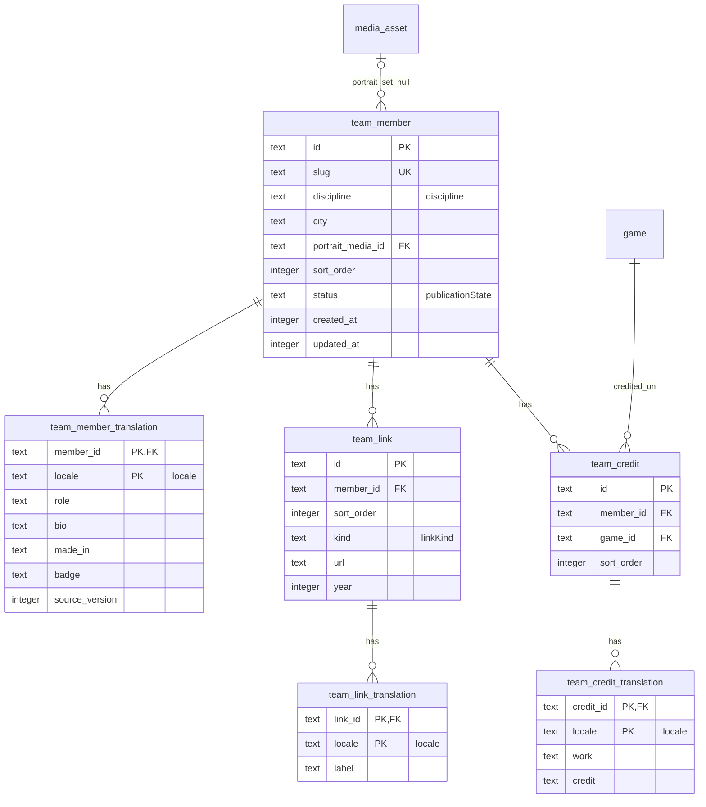
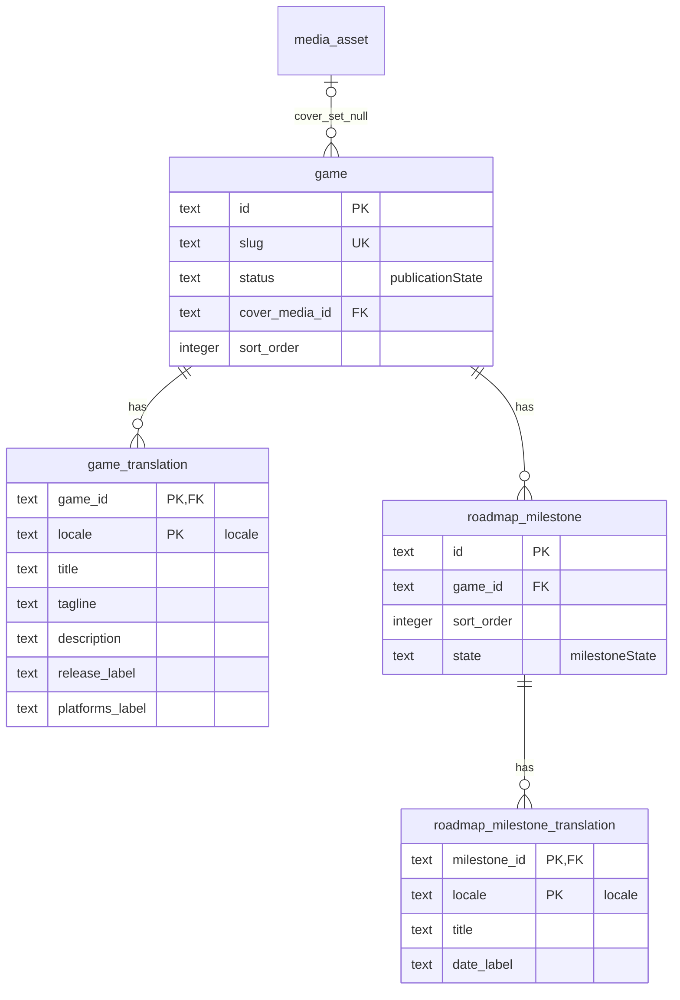
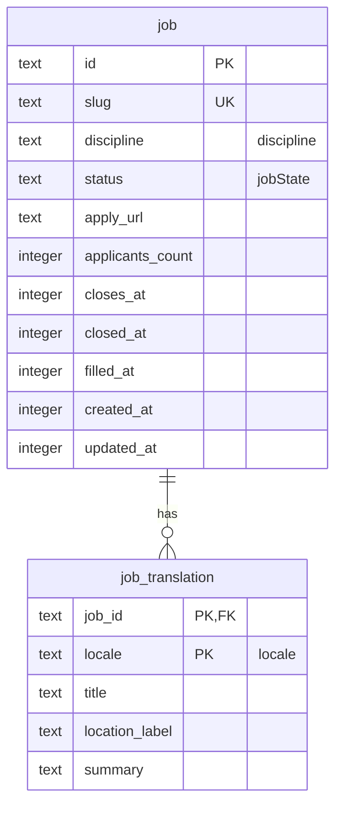
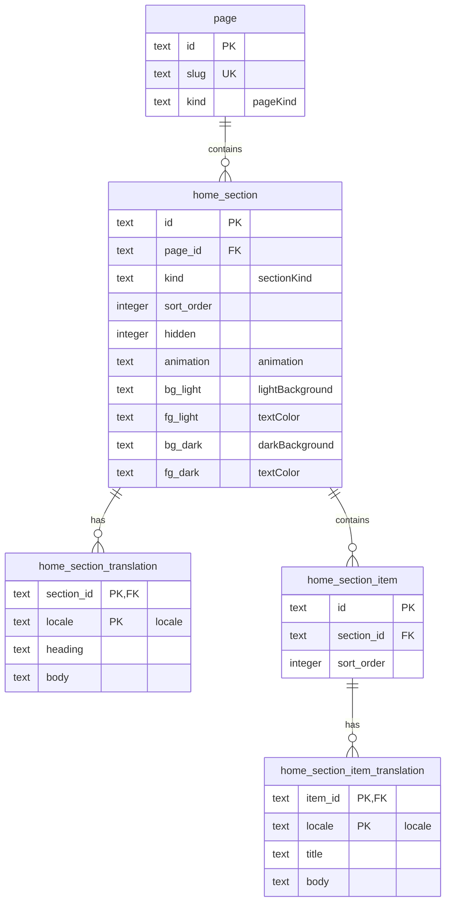
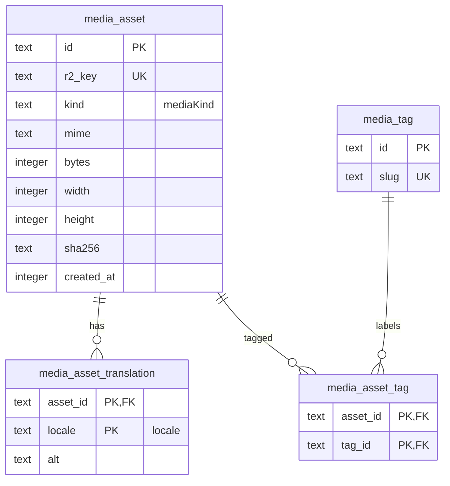
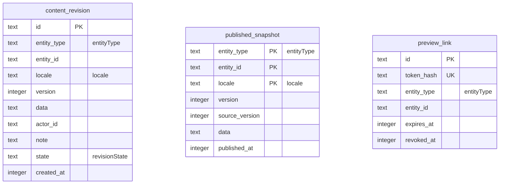
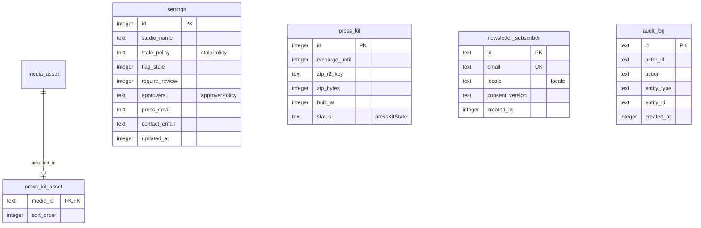

# Database

Lumen stores application data in Cloudflare D1 and defines its schema with Drizzle. `src/db/schema.ts` is the source of truth for tables, columns, and foreign keys. Update this document in the same pull request as any schema change.

## Team

## Games and roadmap

## Jobs

## Pages and home sections

## Media

## Content workflow

## System

## Notes

- The draft tables hold editable and review content; `published_snapshot` holds the published version. Public reads use snapshots only.
- `published_snapshot` and `content_revision` are polymorphic (`entity_type` plus `entity_id`) and have no foreign key. Allowed `entity_type` values are `team_member`, `team_list`, `game`, `job`, and `home`.
- `audit_log.actor_id` intentionally has no foreign key; see [ADR 0006](adr/0006-public-reads-use-published-snapshots.md).
- `settings` and `press_kit` are single-row tables constrained to `id = 1`.
- Enum columns are enforced with SQL `CHECK` constraints generated from `src/db/enums.ts`.
- Every foreign key cascades on delete except the nullable `game.cover_media_id` and `team_member.portrait_media_id` references, which use `SET NULL`.
- Better Auth tables arrive in phase 6 and are not in this schema yet.
